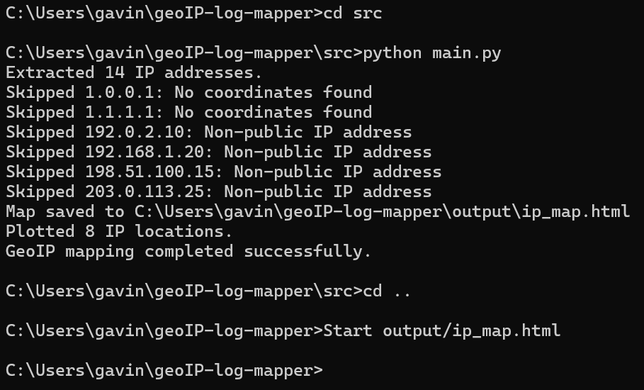
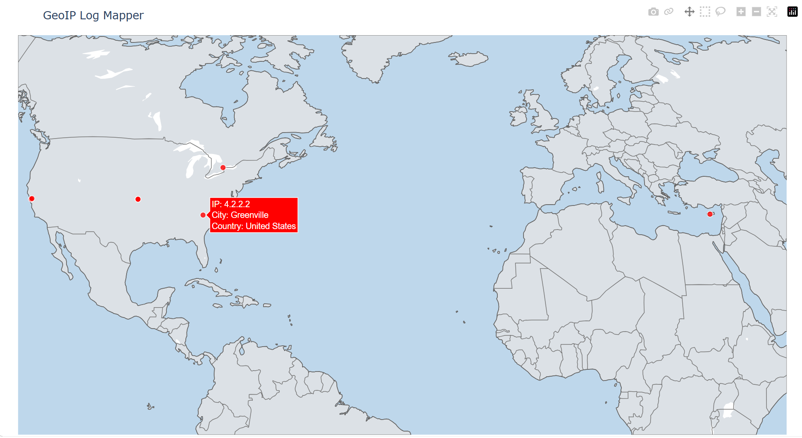
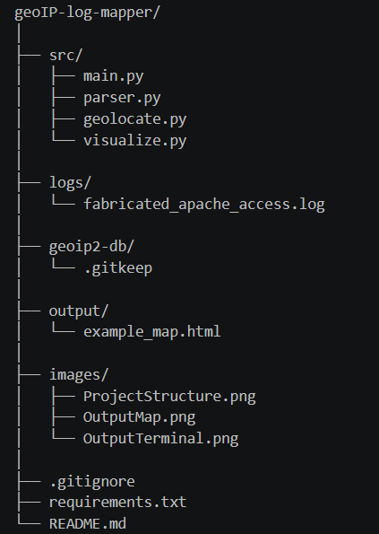

# Overview

This project is a GeoIP Log Mapper, which takes IP addresses from server log files and maps their geographic locations on an interactive world map. I built this tool to practice working with log data, understand how IP addresses can reveal information about network activity, and learn how to visualize that data. This tool helps visualize the approximate geographic origins of network traffic, providing additional context for investigating suspicious activity. While IP geolocation cannot definitively identify an attacker's physical location, it can help security analysts identify unusual traffic patterns and prioritize further investigation. It’s relevant to cybersecurity because being able to trace IPs back to their origin can help detect suspicious activity, such as brute-force attacks or unauthorized access attempts from unusual regions. Security Operations Center (SOC) analysts, cybersecurity learners, and developers who want to better understand network behavior could all benefit from a tool like this.

# Features

## Log File Parsing

Extracts unique IPv4 addresses from Apache access logs using regular expressions.

## GeoIP Lookup

Uses the locally stored MaxMind GeoLite2-City database to retrieve approximate geographic information, including country, city, latitude, and longitude.

## Interactive Map Visualization

Uses Plotly to display geolocated IP addresses on an interactive world map.

## Offline Map Viewing

Generates a self-contained HTML visualization that can be opened without an internet connection or external map tile services.

## IP Address Validation

Validates IPv4 addresses and excludes private, reserved, and other non-public addresses from geolocation.

## Error Handling

Skips addresses that cannot be geolocated and provides messages explaining why.

## Modular Code Design

Separates log parsing, geolocation, visualization, and program execution into individual Python modules.

## Apache Access Log Support

Supports standard Apache access logs and includes synthetic sample data for testing and demonstration.

# Tools & Technologies

## Python 3

Core programming language used to implement the project.

## Plotly

Generates interactive geographic visualizations and self-contained HTML maps.

## GeoIP2

Python library used to query the MaxMind GeoLite2-City database.

## MaxMind GeoLite2-City Database

Locally stored geolocation database used to retrieve approximate geographic information for public IP addresses.

## Regular Expressions (re)

Extracts IPv4 addresses from Apache access logs.

## ipaddress

Python standard library module used to validate IP addresses and identify non-public addresses.

## pathlib

Handles file and directory paths independently of the current working directory.

# Setup & Installation

## 1. Clone the repository

git clone
https://github.com/Gavin-Main/geoIP-log-mapper/

## 2. Install dependencies

python -m pip install -r requirements.txt

## 3. Configure the GeoIP Database

Create a free account at MaxMind.

Download the GeoLite2 City database in MMDB format.

Extract the database file.

Place GeoLite2-City.mmdb inside the project's geoip2-db/ directory.

## 4. Run the Program

python src/main.py

The program extracts IP addresses from the configured Apache access log, retrieves available geolocation information, and generates an interactive map.

## 5. View the Map

Generated file: output/ip_map.html

On Windows: Start output\ip_map.html

Your browser will then open a map with icons marking the location of the IPs in the log file

Note: The repository also includes output/example_map.html, a pre-generated demonstration that can be viewed without installing Python or downloading the GeoLite2 database.

# Using your own Apache Access Log
	
To generate a map from a different Apache access log:

## 1. Place your access-log file inside the project's logs/ directory.

## 2. Open src/main.py.

## 3. Update the log_file variable to reference your file.

For Example:
log_file = project_root / "logs" / "my_access.log"

## 4. Save your changes and run:

python src/main.py 

The program will process the new log file and generate output/ip_map.html.

Note: Running the program again will overwrite any previous ip_map.html.

The current parser expects Apache access-log entries beginning with an IPv4 address.

# Usage Examples

The following examples demonstrate the GeoIP Log Mapper processing a synthetic Apache access log.

The program extracts unique IPv4 addresses, validates them, and uses the GeoLite2-City database to retrieve available geographic coordinates.

Addresses that cannot be geolocated are skipped, while successfully resolved addresses are plotted on an interactive world map.

The synthetic dataset includes examples of normal web traffic, failed requests, and requests to potentially sensitive endpoints. All traffic is simulated for demonstration purposes.

Once cloned into the repository, you can run the program with python src/main.py. Then once mapping completes, run Start output/ip_map.html to open the map in your browser.

Map opens with 8 points plotted on the map from the sample access log. The tool bar in the top right can help you navigate the map and you can hover the cursor over the points to see more information.

# Project Structure

main.py: Main script that runs all scripts.

parser.py: Extracts IP addresses from log files.

geolocate.py: Looks up geographic info for each IP address.

visualize.py: Creates interactive map with IP data.

logs/: Contains fabricated sample access log with IP addresses.

geoip2-db/: Contains .gitkeep to track unused directory until the user downloads the database separately.

output: Stores pregenerated demonstration (example_map.html), but when users generate a new map it will be stored in this directory as 'ip_map.html'.

# Security Context / Learning Outcomes

This project helped me understand how IP addresses found in log files can be used to analyze network activity, which is an important part of cybersecurity. Geolocating IPs and mapping them visually allowed me to see where traffic is coming from, which can help identify unusual or potentially malicious activity—like login attempts from unexpected countries. These kinds of insights are useful in real-world security operations, such as threat detection, incident response, and access monitoring. Through this project, I gained hands-on experience working with logs, interpreting IP data, and using external tools like geolocation databases and visualization libraries—all of which are relevant skills in the cybersecurity field.

An additional learning experience involved improving the reliability of the project's visualization component. The original implementation relied on externally hosted map tiles, which could become unavailable due to service restrictions. I replaced this approach with Plotly, allowing the program to generate self-contained interactive HTML maps that can be viewed offline. When tested using the included fabricated Apache access log, the program extracted 14 unique IPv4 addresses and successfully plotted 8 geographic locations. Addresses that were non-public or lacked geographic coordinates were excluded from the visualization. This helped me better understand the importance of managing external dependencies and designing software that remains functional when third-party services are unavailable.

# Known Limitations
	
## IPv4 Support Only

The current parser supports IPv4 addresses in standard Apache access logs. IPv6 addresses and other log formats are not yet supported.

## Approximate Geolocation

IP geolocation provides estimated geographic locations and cannot reliably identify the exact physical location of a user or attacker.

## Database Coverage

Some valid public IP addresses may not have geographic coordinates available in the GeoLite2-City database.

## No Automated Threat Detection

The tool visualizes IP address locations but does not currently determine whether an address is malicious.

## Unique IP Visualization

Each unique IP address is plotted once, regardless of how many requests it made. Request frequency and traffic analysis are planned improvements.

## Manual Log Selection

Users currently select the input log file by modifying its path in main.py.

# Future Improvements

## Improve Geolocation Coverage 

Evaluate additional GeoIP databases and geolocation providers to improve IP address coverage and geographic accuracy.

## Integrate Threat Intelligence APIs

Incorporate services that provide information about known malicious IP addresses, allowing the program to identify potentially suspicious sources.

## Support Additional Log Formats

Expand parsing capabilities to include SSH authentication logs, firewall logs, and Windows Event Logs.

## Add a Web Interface

Develop a user-friendly interface that allows users to upload log files and generate maps without manually editing Python code.

## Add Traffic Analysis Features

Track request frequency, HTTP status codes, and repeated failed login attempts to provide additional context for security investigations.

## Dockerize the Project

Package the application and its dependencies into a container for easier deployment.

## Improve Error Reporting

Add structured logging and summary statistics for successfully geolocated and skipped IP addresses.

# Attribution

This product includes GeoLite Data created by MaxMind, available from https://www.maxmind.com.
